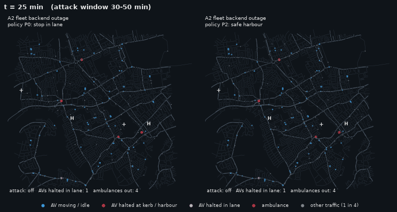
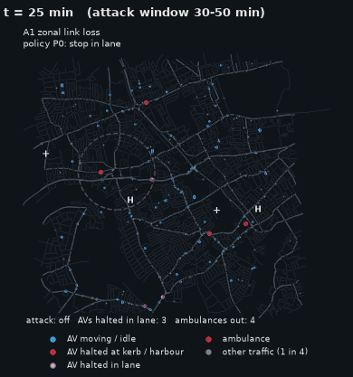
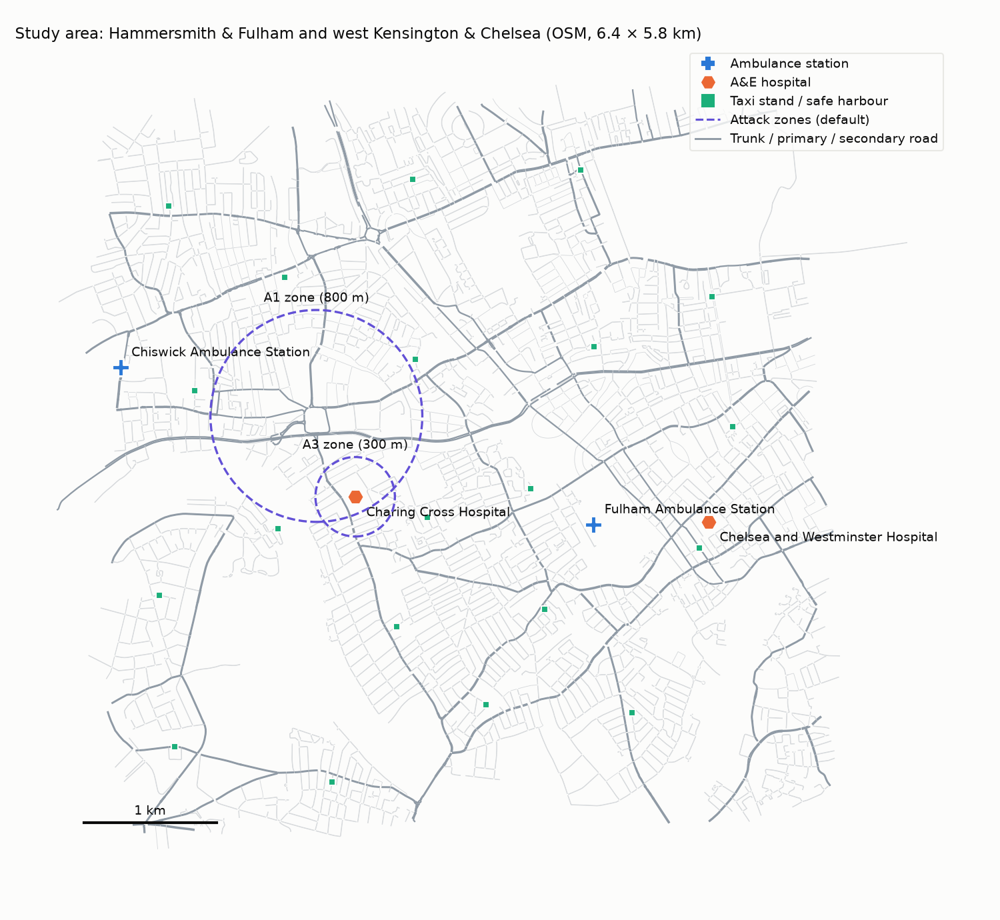
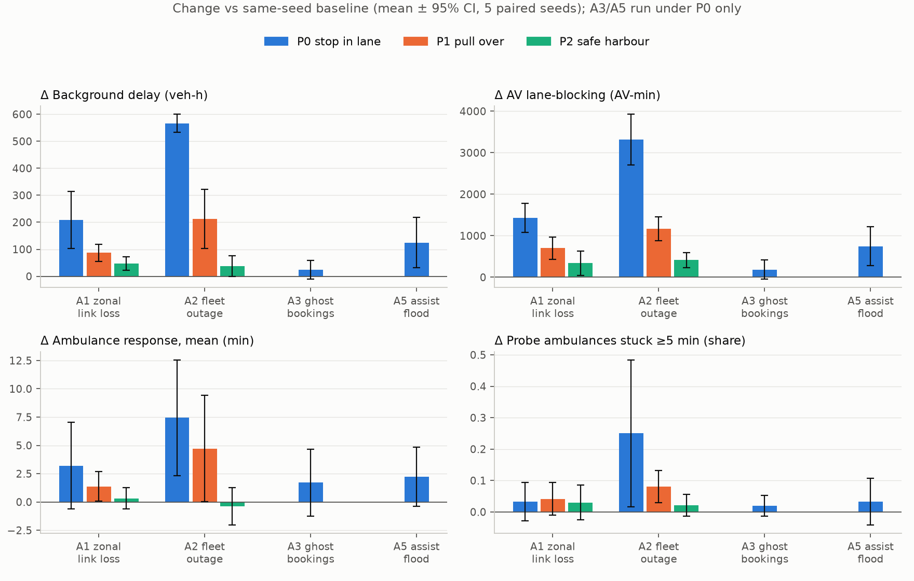

# STRANDED

**S**imulating **T**axi-fleet **R**emote **A**ttacks, **N**etwork **D**elay and **E**mergency **D**ispatch.

Cyber disruption of an autonomous taxi fleet and its effect on congestion and emergency response: an integrated co-simulation of West London. When a robotaxi fleet loses its link to the cloud, vehicles stop. STRANDED models where they stop, who is stuck behind them (passengers, traffic, ambulances), and which fleet response gets everyone moving soonest.

EPSRC CDT in Cyber Physical Risk — Integrator Module 2026-27, Group A.

**Run it now:** jump to [Quick start](#9-running-the-model). It takes about 5 minutes from clone to your first replay.

> **Status: research prototype with preliminary results (Week 8, November 2026).**
> - Batch **v4**: 10 arms × 5 paired seeds, plus 13 check arms × 3 seeds, with 0 failed runs. See [§8.4](#84-preliminary-results-batch-v4).
> - The results are **not yet calibrated or externally validated**.
> - `STATUS.json` and `VALIDATION.md` state exactly what has and has not been verified.

## Demo

**Fleet backend outage (A2), 30–50 min: stop in lane (left) vs safe harbour (right).** Same seed, same traffic, same calls. Under stop-in-lane, 66 robotaxis are halted in traffic lanes at minute 49 (pink); under safe harbour, 2 are (amber = parked off the carriageway).



**Zonal link loss (A1) around Hammersmith Broadway, stop in lane.** Vehicles inside the dashed ring halt where they are; blockage persists after the attack ends because recovery waits for remote-assist operators.



- Simulated minutes 25–75, one frame per 30 s of simulated time. Pink = robotaxi halted in a lane, amber = halted at kerb or harbour, blue = moving or idle, red = ambulance, grey = other traffic (1 in 4 shown), `+` = ambulance station, `H` = A&E.
- Higher-quality MP4s: [A2 side by side](docs/demos/A2_P0_vs_P2.mp4), [A1](docs/demos/A1_P0.mp4).
- Interactive replays with a slider (download, then open in a browser; GitHub shows only the source): [A2 stop in lane](docs/demos/A2_P0_replay.html), [A2 safe harbour](docs/demos/A2_P2_replay.html), [A1 stop in lane](docs/demos/A1_P0_replay.html).
- These are single illustrative runs (seed 1). The numbers to cite are the paired multi-seed results in [§8.4](#84-preliminary-results-batch-v4).

---

## Contents

1. [Research context](#1-research-context)
2. [Study area](#2-study-area)
3. [Model architecture](#3-model-architecture)
4. [Implementation details](#4-implementation-details)
5. [Attacks, policies and scenarios](#5-attacks-policies-and-scenarios)
6. [Outcome metrics](#6-outcome-metrics)
7. [Parameters and evidence grades](#7-parameters-and-evidence-grades)
8. [Validation, checks, limitations and preliminary results](#8-validation-checks-and-known-limitations)
9. [Running the model](#9-running-the-model)
10. [Repository layout](#10-repository-layout)
11. [Working method](#11-working-method)
12. [Roadmap](#12-roadmap)
13. [Data, licences and use of AI](#13-data-licences-and-use-of-ai)

---

## 1. Research context

Robotaxi services from Waymo, Wayve and others are expected in London from 2026. A city-wide fleet depends on shared cloud services: booking and dispatch, routing, vehicle-to-cloud (V2C) connectivity and remote assistance. A single cyber fault or attack on those services can therefore affect many vehicles at once.

The London Assembly Transport Committee's 2026 report on autonomous transport flags **"interaction with emergency services"** as a key uncertainty.

**Scoping review** (protocol v2, 9 Nov 2026). The main question: *what is known about cyber disruptions to the shared services that coordinate commercially deployed autonomous taxi fleets, and how do such disruptions propagate into road congestion and emergency vehicle access in dense urban environments?* It has three sub-questions:
- **RQ1:** attack and failure types;
- **RQ2:** effects on fleets, congestion and emergency travel times;
- **RQ3:** mitigation and recovery mechanisms.

**Practical research question (this repository).**
> For each class of cyber disruption and operating context, which fleet contingency policy minimises harm to emergency response and network performance, and how robust is that choice to parameter uncertainty and adversarial targeting?

**Intended contributions** (a publication beyond the module; target venues TR Part C or IEEE T-ITS):

| # | Contribution | Artefact |
|---|---|---|
| C1 | Attack scenario library grounded in the scoping review. Every parameter is graded evidence / assumption / illustrative. | `avsim/attacks.py`, `params.csv` |
| C2 | Coupled co-simulation: traffic ↔ fleet management ↔ remote assistance ↔ EMS dispatch, with explicit feedback loops. | this repository |
| C3 | Benchmark matrix: attack × context × contingency policy → harm metrics, giving a **coordinator decision table**. | `batch.py`, `scripts/analyse.py` |
| C4 | Design thresholds and worst-case analysis: operators per 100 AVs needed to protect ambulance response times, and adversarial placement (which junctions matter most). | planned, weeks 12–14 |

## 2. Study area



| Item | Value |
|---|---|
| Boroughs | London Borough of Hammersmith & Fulham; western Royal Borough of Kensington & Chelsea |
| Bounding box | 51.465–51.512 °N, 0.245–0.170 °W |
| Extent | 6.4 × 5.8 km (≈ 37 km²) |
| Road network | 9,129 directed edges, 3,950 junctions, 125 signalised junction groups, 626 road-km, 689 lane-km (passenger-accessible) |
| Edge types | residential 6,170; primary 1,368; tertiary 507; secondary 364; trunk 309; unclassified 281; living street 76; links 54 |
| Traffic rule | **left-hand traffic** (`netconvert --lefthand`) |
| Ambulance stations | Fulham Ambulance Station, 150 Seagrave Road (51.4844, −0.1939), 4 units (assumed); Chiswick Ambulance Station, Goldhawk Road (51.4963, −0.2446), 3 units (assumed) |
| A&E hospitals | Charing Cross Hospital, Fulham Palace Road (51.4869, −0.2196); Chelsea and Westminster Hospital, Fulham Road (51.4843, −0.1813) |
| Taxi stands / safe harbours | 20, spread by k-means over stop-able kerbside edges, 12 kerb spaces each |
| Stop-able kerbside | 5,843 edges (primary to living street, ≥ 30 m, in the largest strongly connected component), ≈ 20,000 usable kerb spaces at the default `kerb_fraction` 0.3 |

Why this area:
- It contains two A&E hospitals and two ambulance stations.
- It has a dense mix of trunk roads (A4 / Great West Road, A219 Fulham Palace Road, A3220) and residential grids.
- It has known bottlenecks: the **Hammersmith gyratory and flyover**, and Hammersmith and Putney bridges.
- It includes a regular major-event generator (Stamford Bridge).
- It is a plausible early robotaxi operating area.

Hammersmith Hospital and St Mary's lie just outside the box.

## 3. Model architecture

```
            ┌──────────── CYBER: attack injector (scenario YAML) ────────────┐
            │ type · onset · duration · zone (centre, radius) · rate          │
            ▼                         ▼                          ▼
  ┌──────────────────┐   ┌───────────────────────┐   ┌─────────────────────┐
  │ FLEET MANAGEMENT │◄─►│ REMOTE-ASSIST CENTRE  │   │ CONTINGENCY POLICY  │
  │ dispatch, stands │   │ FIFO queue, K ops,    │   │ P0 / P1 / P2 on     │
  │ heartbeat, MRC   │   │ lognormal service     │   │ link loss           │
  └────────┬─────────┘   └───────────┬───────────┘   └─────────┬───────────┘
           │      libsumo / TraCI: setStop · changeTarget · resume · setSpeed
           ▼                                                     ▼
  ┌──────────────────────────────────────────────────────────────────────────┐
  │ PHYSICAL: SUMO 1.28 microsimulation (1 s step), West London OSM network   │
  │ background traffic · 150 robotaxis · ambulances (red-light pass, 1.2× speed) │
  │ signals · lane occupancy · queues and spillback · kerb capacity           │
  └──────────────────────────────────┬───────────────────────────────────────┘
                                     ▼
  ┌──────────────────────────────────────────────────────────────────────────┐
  │ EMS: Poisson incidents → nearest station with a free unit → scene →       │
  │ (convey) hospital → handover → return; response = arrival − call          │
  └──────────────────────────────────────────────────────────────────────────┘
```

The Python layers and SUMO exchange state **every simulated second** in one process (libsumo). The model is integrated rather than side by side because of the feedback loops below. Each loop is explicit in the code:

| Loop | Mechanism | Code |
|---|---|---|
| **Link loss → halt → blockage** | AVs that lose the link for longer than the heartbeat timeout perform a minimal-risk-condition (MRC) stop. Where they stop depends on the policy; an in-lane stop occupies the lane. | `sim._fleet_step`, `_on_link_lost`, `_halt_here` |
| **Blockage → congestion → ambulance delay** | SUMO car-following, lane changing and signal queues propagate the blockage. Ambulances drive in that traffic at 1.2× the speed limit and may cross red lights at ≤ 20 km/h. Other drivers do not actively yield (see limitations). | SUMO |
| **Congestion → assist demand → longer holds** (positive feedback) | An AV waiting > `stuck_wait_s` in traffic asks for remote assistance with probability `p_stuck_assist` and holds its lane until served. | `_fleet_step` |
| **Assist queue → recovery time** | Every halted AV needs an operator to clear it after the link returns. With K operators the queue sets how long blockages last; A5 adds fake load. | `_assist_step` |
| **Ghost bookings → convergence → dwell** | Fake trip requests draw AVs to one zone. Each waits `no_show_wait_s` at the kerb, or in the lane once the kerb is full. | `_dispatch`, `_place_stop` |
| **Kerb capacity → lane blocking** | Kerb space per edge is finite. When it is full, pickups, drop-offs and pull-overs stop in the lane. | `kerb_used`, `world.kerb_cap` |

## 4. Implementation details

### 4.1 Network (`scripts/build_net.sh`, `avsim/world.py`)

- **Source data.** OSM road ways (motorway to service) were fetched from the Overpass API on 2026-11-23 and stored in `data/osm/west_london.osm.xml`.
- **Conversion.** `netconvert` with the OSM type map and these options:
  - `--lefthand`;
  - `--opposites.guess`;
  - signal guessing and joining (actuated);
  - junction joining and geometry simplification;
  - pedestrian and cycle edges removed;
  - largest component kept;
  - UTM projection.
- **Stops.** `world.build` keeps as stop-able only edges in the **largest strongly connected component**, so every stop can be reached and left.
- **Kerb lanes.** For each edge and vehicle class it records the kerbside lane that allows that class (lane 0 is the kerb lane in SUMO, also in left-hand networks).
- **Kerb capacity.** `floor(length / 7 m × kerb_fraction)`.
- **Stands.** 20 stands, placed by deterministic k-means over stop-able edges (≥ 60 m), with capacity raised to 12 spaces.
- **EMS sites.** Read from `data/ems_sites.csv` (OSM via Nominatim) and snapped to the nearest emergency-accessible edge within 200 m.

### 4.2 Exogenous inputs and common random numbers (`avsim/demand.py`)

Every stochastic input is drawn from its own seeded stream, so an attack arm and the baseline with the same seed see **identical** inputs. Differences between them are paired, not seed noise.

| Input | Stream | Model |
|---|---|---|
| Background traffic | SUMO `randomTrips.py --seed` | uniform OD over passenger edges, fringe factor 5, one vehicle per 1.0 s (≈ 3,600 veh/h). Cached per seed in `data/cache/`. |
| Robotaxi requests | `[seed, 101]` | Poisson, 300/h, uniform origin and destination over stop-able edges |
| EMS incidents | `[seed, 202]` (+ `[seed, 203]` conveyance draw) | Poisson, 6/h, location weighted by edge length |
| Ghost bookings (A3) | `[seed, 303, k]` | Poisson at `rate_per_h`, origins inside the zone |
| Fake assists (A5) | `[seed, 505, k]` | Poisson at `rate_per_h` |
| Routine assist events | `[seed, 701, taxi, n]` | exponential gaps on each taxi's **own moving-time clock**, so halts elsewhere do not reshuffle them |
| Stuck-assist draws | `[seed, 702, taxi, n]` | Bernoulli(`p_stuck_assist`) per stuck episode |
| Assist service times | `[seed, 703, taxi, n]`, `[seed, 704, 0, n]` | lognormal (mean, CV) per request |

### 4.3 Fleet management system (`avsim/sim.py`)

Each robotaxi is a SUMO vehicle (vType `robotaxi`, passenger class) driven entirely by stops set through TraCI. It never reaches the end of its route without a stop, so it never leaves the network.

**States:**
- `PARKED_IDLE`, `TO_STAND`
- `TO_PICKUP`, `AT_PICKUP`
- `TO_DROPOFF`, `AT_DROPOFF`
- `TO_HARBOUR`, `HALTED`, `HOLD_ASSIST`

**Dispatch** (every 5 s, while the backend is up):
- Pending requests are served FIFO by the nearest idle, connected AV within 3 km (Euclidean).
- Riders cancel after 20 minutes without a pickup.
- During a backend outage (A2), bookings fail ("app down").

**Heartbeat:** an AV reacts to link loss only after the link has been down for `heartbeat_timeout_s` (5 s). Parked idle AVs that lose the link simply cannot be dispatched; only vehicles on the road halt.

**MRC stop placement** (`_halt_here`):
- The stop is placed ahead of the vehicle at a comfortable braking distance, v²/(2·3 m/s²) + 3 m.
- Pull-overs get an extra 30 m to change lanes.
- If the current edge is too short, the stop goes on one of the next three edges of the route.
- If nothing can be placed, `setSpeed(0)` is used and counted as an anomaly.

**Kerb accounting:**
- Kerb spaces are reserved when a kerb stop is placed and released when the vehicle leaves.
- A full kerb turns a requested kerb stop into an **in-lane** stop.

**Remote-assist centre** (`_assist_step`):
- Requests join a single FIFO queue: link-loss recoveries, routine holds, stuck holds, and fakes under A5.
- K operators serve them with lognormal service times.
- When a recovery is served, the AV resumes its plan: continue to drop-off if it has a passenger, otherwise to the pickup if the request is still alive, otherwise to a stand.
- Under A2 the assist centre is down.
- If the AV has lost its link again before help arrives, the request is dropped and re-raised later.

### 4.4 Contingency policies (applied on link loss only)

| Policy | Behaviour | Implementation |
|---|---|---|
| **P0 — stop in lane** (status-quo baseline) | MRC stop ahead in the current lane | `setStop(..., flags=0)` on the current lane |
| **P1 — pull over** | Stop at the kerb if a space exists ahead; otherwise in lane | `setStop(..., flags=1)` (SUMO parking stop, off the lane) |
| **P2 — safe harbour** | Drive on onboard autonomy to the nearest stand with free kerb within 1.5 km, and park; otherwise fall back to P1 | `changeTarget` + parking stop |

The policies differ only after a link loss, so the baseline is identical under P0, P1 and P2 (a null check).

### 4.5 EMS (`_ems_step`, `_launch_amb`, `_amb_update`)

1. An incident becomes dispatchable 30 s after the call.
2. It is assigned to the station nearest by straight-line distance that has a free unit. Incidents with no free unit queue FIFO.
3. The ambulance is inserted at the station with its full route from `findRoute` and a stop at the scene. Insertion delay counts towards the response.
4. Arrival is the first stopped step on the incident edge; **response = arrival − call time**.
5. After 20 min on scene, the patient is conveyed with probability 0.6 (pre-drawn per incident) to the nearest A&E, followed by a 15 min handover. The ambulance then returns to its station, where the unit becomes free.
6. An ambulance that SUMO removes (for example, after a teleport) frees its unit and is counted as an anomaly.

Ambulance vType: emergency class, speed factor 1.2, allowed to cross red lights at ≤ 20 km/h (`jmDriveAfterRedTime`, `jmDriveRedSpeed`). SUMO's **bluelight device is off** and **opposite-lane overtaking is off**, because SUMO 1.28 segfaulted intermittently with the device on (diagnosed on a crashing seed: device off → clean). Other drivers therefore do not form rescue lanes or pull aside for ambulances. This biases ambulance times **upwards in every arm**, and may overstate how much a halted AV delays an ambulance.

### 4.6 Run control

| Setting | Value |
|---|---|
| Simulated time | 0–5,400 s (90 min) at a 1 s step |
| Warm-up | the first 1,800 s are excluded |
| Analysis window | 1,800–5,400 s for every arm |
| EMS call window | calls scored only if made by 4,200 s, leaving ≥ 20 min to be reached |
| Default attack | starts at 1,800 s and lasts 1,200 s (20 min) |
| Collisions | `--collision.action warn`, counted |
| Teleports | `--time-to-teleport 300`, counted by vehicle class |
| Run time | a 90-minute run takes about 1.5–2 min on an Apple-silicon laptop; `batch.py` runs one process per run in parallel |

## 5. Attacks, policies and scenarios

| ID | Attack / failure | Scope | Effect in the model | Default |
|---|---|---|---|---|
| **A1** | Local V2C loss (cellular jamming, base-station DoS) | zone | AVs inside lose the link → MRC by policy | centre Hammersmith Broadway, r = 800 m, 20 min |
| **A2** | Fleet backend outage (e.g. ransomware) | fleet | every AV loses the link; no dispatch; assist centre down | 20 min |
| **A3** | Ghost-booking swarm | point | fake requests draw AVs into the zone; each waits 5 min for a no-show | centre Charing Cross Hospital, r = 300 m, 300 fake/h, 20 min |
| **A5** | Remote-assist flood | operator centre | fake requests (60 s mean to dismiss) join the queue | 600/h (above capacity); `A5_low` 200/h (below) |
| A4, A6, A7, CC1 | route poisoning, GNSS spoofing, malicious OTA update, power cut with dark signals | — | **not yet implemented** (planned, week 9) | — |

**Main experiment (batch v2), 5 seeds each:**
- `baseline`
- `A1_P0`, `A1_P1`, `A1_P2`
- `A2_P0`, `A2_P1`, `A2_P2`
- `A3`, `A5`, `A5_low`

A3 and A5 run under P0 only, because the policies act only on link loss.

**Check arms (`scenarios/null/`), 3 seeds each:** see [Validation](#8-validation-checks-and-known-limitations).

## 6. Outcome metrics

All metrics come from `avsim/metrics.py` (pure functions with unit tests in `tests/`). They are computed over the analysis window and compared with the same-seed baseline as paired differences with 95% t-intervals (`scripts/analyse.py`).

| Metric | Definition | Survivorship / bias rule |
|---|---|---|
| Ambulance response (mean, P90, share > 15 min) | arrival − call, for calls made 1,800–4,200 s | calls never reached are kept, censored at run end, and counted (`n_censored`) |
| Unit wait / travel | dispatch − call − 30 s; arrival − dispatch | — |
| Travel / route estimate | travel ÷ `findRoute` estimate at dispatch time | arrived calls only |
| Background delay (veh-h, £) | SUMO edgeData `timeLoss` for vType `bg_passenger`, pro-rated to the window; £ = veh-h × value of time | includes vehicles still on the road; the insertion backlog is reported separately (`pending_insert_*`) |
| AV lane blocking (AV-min) | time AVs stand in a lane: link-loss halts, assist holds, and in-lane pickup/drop-off dwells | halts still open at the end are censored at the end |
| Stranded passengers (pax-min) | halt time with a passenger on board | as above |
| Assist queue wait (mean, P90, max) | service start − request, genuine requests only | still-queued requests are kept, censored at the end (`assist_n_censored`) |
| Unserved trips | 1 − completed / genuine requests in the window | fakes excluded |
| Integrity counters | teleports by class, collisions, anomalies, insertion backlog | reported for every run |

## 7. Parameters and evidence grades

[`params.csv`](params.csv) lists **every** parameter with:
- its value and unit;
- its grade: **evidence**, **assumption**, **illustrative** or **design**;
- its source or reason;
- **the direction in which it biases the harm estimate**;
- who should check it (usually the review team).

The key ones:

| Parameter | Default | Grade | Why it matters |
|---|---|---|---|
| Background demand | 1 veh/s | illustrative | the highest tested level with a stationary network (≈ 740 vehicles, 22 km/h mean); 0.6 s and 0.8 s supersaturate. **Not yet calibrated to DfT counts.** |
| Fleet size / requests | 150 AVs / 300 trips/h | assumption | exposure at attack onset |
| `kerb_fraction` | 0.3 | assumption | decides whether P1 can actually pull over |
| `heartbeat_timeout_s` | 5 s | illustrative | how far AVs drive into a jammed zone |
| Remote assist: operators / service time | 6 / 180 s (CV 0.6) | assumption / illustrative | recovery duration; swept in C4 |
| Routine assist rate; stuck feedback | 0.5 per moving AV-h; 90 s, p = 0.2 | illustrative | baseline blockage; strength of the feedback loop |
| EMS incident rate | 6 /h | illustrative | a probe rate for statistical power; real Cat-1 rate is lower |
| Cat-1 targets | 7 min mean, 15 min P90 | evidence | NHS England Ambulance Response Programme |
| Value of time | £15 / veh-h | illustrative | placeholder for the DfT TAG databook value |

## 8. Validation, checks and known limitations

### 8.1 Checks run, or running

| Check | Expected | Status |
|---|---|---|
| Metric unit tests (9, positive and negative cases) | pass | **pass** |
| Smoke test: 30 min random traffic | runs, few teleports | **pass** (337× real time, 6 teleports per 2,000 vehicles) |
| Stationarity of the baseline | vehicle count and speed flat after warm-up | **pass** at 1.0 s (≈ 740 vehicles, 6.2 m/s from 15 to 90 min) |
| N_dur0 (A1, 0 s) / N_r0 (A1, 0 m) | identical to baseline | **exactly equal** |
| N_base_P1 / N_base_P2 | identical to baseline | P2 exactly equal. P1 equal except one non-reproducible late divergence (seed 2, 0.6 veh-h; a rerun matched exactly): open issue |
| N_0av_base vs N_0av_A1 | identical EMS outcomes | **exactly equal** |
| N_infops_A1 | assist wait ≈ 0 | **0.00 min**; lane blocking about 60% lower than A1_P0 |
| **N_noise** (SUMO seed only) | paired noise floor, against which effects are judged | delay ±38 veh-h, lane blocking ±14 AV-min, response ±0.4 min |
| N_autoresume_A1 | bounds the "operator needed to restart" assumption | lane blocking +453 vs +1,433 AV-min with operators required |
| N_allkerb_A1_P1 | harm should vanish if it is due to lane blockage | lower (+501 vs +702 AV-min), not zero: assist holds still stand in lanes |
| N_teleoff_base / N_teleoff_A1_P0 | how much the 300 s teleport hides | **inconclusive**: the baseline itself gridlocks without teleports in some seeds |
| Known-case face validity | qualitative match to reported incidents (to be confirmed from sources): Cruise, San Francisco, Aug 2023 multi-vehicle stall after connectivity problems; Cruise–ambulance obstruction reports, San Francisco 2023; Waymo, San Francisco, Dec 2025 blackout stalls | planned, week 12 |
| Global sensitivity (Morris / Sobol) on illustrative parameters | — | planned, week 12 |

### 8.2 Blind red team

A fresh, read-only agent reviewed the code with no access to our notes. Its verdict was **pass as a progress demo, fail as a paper**. Its high-confidence faults have been fixed:
- a shared random stream broke common random numbers;
- late EMS calls were scored short;
- lost ambulances were never freed;
- in-lane dwells and queued assists were missed.

The full report and the status of each fault are in [`ledger/reviews/redteam-1.md`](ledger/reviews/redteam-1.md). The first batch, which ran on the faulty code, was discarded unanalysed.

### 8.3 Known limitations (open)

- **Ambulances have no blue-light priority beyond crossing red lights slowly**: no rescue lanes, no opposite-lane overtaking (both disabled after SUMO 1.28 crashes). Behind a halted AV on a single-lane road, the delay is bounded only by SUMO's 300 s teleport. This **overstates** EMS delay. The teleport-off arms measure the effect.
- **P1's benefit rests on kerb bookkeeping.** SUMO parking stops take no physical space, so whether P1 works depends on `kerb_fraction` (an assumption).
- **Every link-loss halt needs an operator**, so recovery time is set by `operators` and `service_mean`. Bounded by N_autoresume_A1 and swept in C4.
- **Background demand is uniform random OD**, not calibrated. There is no bus network, and no pedestrian or cyclist interaction.
- **Dispatch uses straight-line distance**, both for robotaxis and for the nearest ambulance station; it is not LAS's actual dispatch logic.
- **Collisions** occur at a low rate and are logged, not prevented.
- **A4, A6, A7 and CC1** are not yet implemented; there is no coordinator agent (detection delay, geofencing) yet.

### 8.4 Preliminary results (batch v4)



These are paired differences from the same-seed baseline: mean ± 95% t-interval over **5 seeds**, judged against the N_noise floor. Full tables are in [`docs/results/results_v4.md`](docs/results/results_v4.md), and the check arms are in [`docs/results/checks_null4.md`](docs/results/checks_null4.md).

Baseline values for reference:
- background delay 122 veh-h over 1 h;
- AV lane blocking 109 AV-min;
- ambulance response 8.2 min mean;
- unserved trip share 0.23.

| Arm | Background delay (veh-h) | AV lane blocking (AV-min) | Stranded pax (pax-min) | Assist wait (min) | Unserved trips (pp) | Ambulance response (min) |
|---|---|---|---|---|---|---|
| A1 zonal link loss, P0 stop in lane | +208 ± 105 | +1,433 ± 350 | +944 ± 247 | +7.4 ± 2.8 | +19 ± 10 | +3.2 ± 3.8 |
| A1, P1 pull over | +87 ± 31 | +702 ± 270 | +973 ± 231 | +6.9 ± 2.4 | +13 ± 9 | +1.4 ± 1.3 |
| A1, P2 safe harbour | +47 ± 25 | +338 ± 291 | +769 ± 347 | +5.5 ± 3.1 | +9 ± 6 | +0.3 ± 0.9 |
| **A2 fleet outage, P0 stop in lane** | **+566 ± 34** | **+3,314 ± 613** | **+2,259 ± 342** | **+14.3 ± 2.3** | **+58 ± 9** | **+7.4 ± 5.1** |
| A2, P1 pull over | +212 ± 110 | +1,171 ± 289 | +2,001 ± 323 | +14.1 ± 2.2 | +46 ± 7 | +4.7 ± 4.7 |
| A2, P2 safe harbour | +38 ± 38 | +416 ± 182 | +1,911 ± 240 | +13.9 ± 2.0 | +42 ± 5 | −0.4 ± 1.7 |
| A3 ghost bookings (P0) | +24 ± 35 | +184 ± 232 | +23 ± 78 | +0.6 ± 1.4 | +2 ± 2 | +1.7 ± 3.0 |
| A5 assist flood, above capacity (P0) | +125 ± 94 | +749 ± 463 | +547 ± 398 | +10.4 ± 3.5 | +16 ± 10 | +2.2 ± 2.6 |
| A5 assist flood, below capacity (P0) | +2 ± 9 | +0 ± 10 | −1 ± 14 | +0.1 ± 0.1 | +1 ± 1 | −0.2 ± 0.5 |

**What the model currently says** (preliminary; the assumptions are in §7 and the limitations in §8.3):
1. **A fleet-wide backend outage is the dominant threat**, and **stop-in-lane is the worst response to it**. It roughly quintuples background delay in the analysis hour and adds about 7 minutes to mean ambulance response. It is the only ambulance effect whose CI excludes zero at n = 5. Probe ambulances agree: a 25 ± 23 pp higher share are stuck for 5 minutes or more.
2. **Where vehicles stop matters more than whether they stop.** Policy ordering P0 > P1 > P2 holds for delay and lane blocking under both A1 and A2. Driving to a safe harbour removes about 93% of A2's extra background delay and the ambulance effect.
3. **No stopping policy helps the passengers.** Stranded-passenger minutes and assist waits (about 14 min under A2) are about the same under P0, P1 and P2. Recovery is limited by **remote-assist capacity**, not by where vehicles wait. With unlimited operators or auto-resume, A1 lane blocking falls by 60–70%. This is the lever studied in C4.
4. **The remote-assist centre is itself an attack surface, with a cliff.** Flooding it above operator capacity produces physical blockage and delay without touching any vehicle. The same attack below capacity has no measurable effect.
5. **Ghost bookings (A3) at the tested intensity** have small effects that are not statistically significant.

**How far to trust these numbers:** 5 seeds; uncalibrated background demand; illustrative assist parameters; ambulances without the SUMO bluelight device; a single study area and time of day. The direction and ordering of effects are the robust part. Treat magnitudes as illustrative until calibration and sensitivity analysis (weeks 11–12) are done.

## 9. Running the model

### 9.1 What you need

- **Python 3.11 or newer** (tested on 3.13). Check with `python3 --version`.
- **Git**, and access to the CPR-CDT GitHub organisation.
- About **1 GB of disk** for the Python environment, and **2 GB of RAM** per simulation running at once.
- **No separate SUMO install.** SUMO 1.28 comes from pip (`eclipse-sumo`), with binaries for macOS, Linux and Windows.

### 9.2 Quick start (about 5 minutes)

**Step 1 — Get the code.**
```bash
git clone git@github.com:CPR-CDT/SUMO-simulation.git
cd SUMO-simulation
```
> If you see `Password authentication is not supported`, you used the `https://` address. Use the `git@github.com:` (SSH) address above, which needs an SSH key added to your GitHub account.

**Step 2 — Create an isolated Python environment and install everything (1–3 min).**
```bash
python3 -m venv .venv
.venv/bin/pip install -r requirements.txt
```
On **Windows**, use `.venv\Scripts\python` wherever this guide says `.venv/bin/python`. For example: `.venv\Scripts\pip install -r requirements.txt`.

**Step 3 — Check the install.**
```bash
.venv/bin/python -c "import sumo, libsumo; print('SUMO OK:', sumo.SUMO_HOME)"
.venv/bin/python -m pytest -q tests
```
You should see `SUMO OK` and `9 passed`.

**Step 4 — Run one scenario (about 2 min).** This is the A1 attack (connectivity loss around Hammersmith Broadway) with the stop-in-lane policy:
```bash
.venv/bin/python run.py scenarios/A1_P0.yaml --seed 1 --replay
```
- The run prints its metrics as JSON when it finishes, and writes everything to `runs/A1_P0_s1/`.
- `Warning: Could not set locale to 'C'` is harmless.
- `--replay` records vehicle positions every 5 s for the animation.

**Step 5 — Watch it.**
```bash
.venv/bin/python scripts/make_replay.py runs/A1_P0_s1
open runs/A1_P0_s1/replay.html        # macOS; on Windows: start runs\A1_P0_s1\replay.html ; on Linux: xdg-open ...
```
The page is self-contained (≈ 8 MB) and works offline in any browser.
- **Colours:** blue = robotaxis moving or idle; pink = halted **in a lane**; amber = halted at the kerb or in a harbour; red = ambulances.
- **Markers:** the dashed ring is the attack zone, `+` marks ambulance stations and `H` marks hospitals.
- **Controls:** use the slider and speed menu to scrub through the 90 minutes.

**Step 6 — Compare with the baseline.** Every arm is meant to be compared with the **same-seed baseline**:
```bash
.venv/bin/python run.py scenarios/baseline.yaml --seed 1
```
Then compare `runs/baseline_s1/summary.json` with `runs/A1_P0_s1/summary.json`. The keys are explained in [§6](#6-outcome-metrics).

### 9.3 Running the full experiment

```bash
# 10 arms × 5 seeds = 50 runs. With --jobs 7 this takes ~25–35 min on an 8-core laptop.
# Set --jobs to (CPU cores − 1).
.venv/bin/python batch.py --tag v2 --seeds 1 2 3 4 5 --jobs 7 \
    scenarios/baseline.yaml scenarios/A1_P0.yaml scenarios/A1_P1.yaml scenarios/A1_P2.yaml \
    scenarios/A2_P0.yaml scenarios/A2_P1.yaml scenarios/A2_P2.yaml scenarios/A3.yaml scenarios/A5.yaml scenarios/A5_low.yaml

# Check arms (null cases, noise floor, sensitivity bounds), 3 seeds:
.venv/bin/python batch.py --tag null2 --seeds 1 2 3 --jobs 7 scenarios/baseline.yaml scenarios/null/*.yaml

# Paired differences vs baseline with 95% CIs: writes runs/results_v2.md (table) and runs/fig_v2.png (figure)
.venv/bin/python scripts/analyse.py runs/batch_v2.csv
```
- `batch.py` prints one line per finished run and writes `runs/batch_<tag>.csv`, one row per run.
- A run that fails shows `ERROR` with the last lines of its error, and the batch carries on.

### 9.4 Making your own scenario

A scenario is a small YAML file that overrides any default in `avsim/config.py` (`DEFAULTS`). Every default is documented in `params.csv`. For example, `scenarios/my_test.yaml`:
```yaml
name: A1_P1_big_zone          # output folder: runs/A1_P1_big_zone_s<seed>/
policy: P1                    # P0 stop in lane | P1 pull over | P2 safe harbour
fleet: {n_taxis: 300}         # twice the fleet
assist: {operators: 12}       # twice the remote-assist staff
attacks:
  - {type: A1, start_s: 1800, duration_s: 1800, centre: hammersmith_broadway, radius_m: 1200}
```
Run it with `.venv/bin/python run.py scenarios/my_test.yaml --seed 1`.
- **Attack types:** `A1` (zone link loss), `A2` (fleet outage), `A3` (ghost bookings; needs `rate_per_h`), `A5` (assist flood; needs `rate_per_h`). Several can be listed.
- **Named centres** (in `avsim/attacks.py`): `hammersmith_broadway`, `charing_cross_hosp`, `chelsea_westminster_hosp`, `fulham_broadway`, `earls_court`. Or give `[lat, lon]`.
- **Shorter test runs:** `--end 2400` stops at 40 simulated minutes.
- **Keep comparisons paired:** compare arms only with a baseline of the same seed and the same non-attack settings.

### 9.5 Other tools

| Task | Command |
|---|---|
| Redraw the study-area map | `.venv/bin/python scripts/plot_area.py` → `docs/study_area.png` |
| Render runs as MP4 + GIF (side by side if several) | `.venv/bin/python scripts/make_video.py docs/demos/name runs/A2_P0_s1 runs/A2_P2_s1` (runs need `--replay`) |
| Rebuild the SUMO network from the stored OSM extract | `scripts/build_net.sh` (≈ 30 s) |
| Watch in SUMO's own GUI (slower) | `AVSIM_TRACI=1 .venv/bin/python run.py ...` uses socket TraCI. Replace `sumo` with `sumo-gui` in `avsim/sim.py:start` for the GUI. On macOS the GUI needs XQuartz. |

### 9.6 Troubleshooting

| Symptom | Cause and fix |
|---|---|
| `ModuleNotFoundError: libsumo` / `sumo` | The environment isn't active or the install failed: rerun step 2 and call `.venv/bin/python` explicitly. |
| Run exits with code 139 / −11 (segfault) | A SUMO crash. It was traced to SUMO's bluelight device, now off (`ems.bluelight: false`). If it recurs, rerun with `AVSIM_TRACI=1` to find the simulated time, and report it with the scenario and seed. Never drop crashed runs silently: `batch.py` lists them as `ERROR`. |
| `Overpass ... at capacity` when refetching OSM | The public Overpass server is busy. The repository already contains the extract, so you only need it to change the area. Retry later, or use a mirror. |
| Very slow runs or a growing vehicle count in `ts.csv` | Background demand too high for the network (`background.period_s` below about 1.0 supersaturates). Keep the default unless you are calibrating. |
| First run is slow | The first run for each seed generates background routes (≈ 10 s) and caches them in `data/cache/`. |

**Outputs per run** (`runs/<name>_s<seed>/`):

| File | Contents |
|---|---|
| `summary.json` | all metrics |
| `incidents.csv`, `halts.csv`, `requests.csv`, `assist.csv` | event records |
| `ts.csv` | 30 s time series |
| `edgedata.xml` | SUMO per-edge delay |
| `stats.xml` | SUMO statistics |
| `config.json` | the resolved configuration |
| `replay.json` | replay frames, when `--replay` is used |

## 10. Repository layout

```
avsim/
  config.py      defaults (every value has a params.csv row) + YAML loader
  world.py       network, stop-able edges, kerb capacity, stands, EMS sites
  demand.py      background routes, taxi requests, EMS incidents (common-random-number streams), vehicle types
  attacks.py     attack injector (A1, A2, A3, A5)
  sim.py         co-simulation loop: fleet management, assist centre, policies, EMS
  metrics.py     outcome metrics (pure, tested)
run.py           one scenario
batch.py         scenarios × seeds in parallel
scripts/         build_net.sh, analyse.py, make_replay.py, make_video.py, plot_area.py
scenarios/       main arms; null/ = check arms
tests/           metric unit tests
data/            OSM extract, SUMO network, EMS sites (cache/ is generated)
docs/            figures, results tables, demos/ (videos and interactive replays)
requirements.txt pinned Python dependencies (SUMO included)
params.csv       parameter register (value, grade, source, bias direction)
DECISIONS.md     decision and assumption log
ledger/          work-item cards and reviews (red team)
```

## 11. Working method

The project follows a production-line method adapted from a colleague's agentic engineering playbook, used before on a robotics benchmarking project:

- **Rules and state live in files, not chat.**
  - `DECISIONS.md` logs every decision.
  - `params.csv` registers every parameter.
  - `ledger/cards/*.json` holds one card per work item, with its stage, checks and next step.
- **Gated stages.** Work moves build → red team → QA → owner look → done.
- **Fresh agents for checks.** Every check is done by a fresh agent with no access to the builder's notes, so it is not anchored on the builder's account.
- **Red team as artefact hunt.** It asks whether a reported effect could appear without the mechanism we claim: teleports, warm-up, survivorship, random-number pairing, censoring.
- **Null and limiting cases** run with real numbers before any effect is reported. Effects are judged against a measured noise floor.
- **Direction of bias.** Every assumed parameter records which way it pushes the result.
- **Honest status.** `STATUS.json` and `VALIDATION.md` claim only what has been run.

## 12. Roadmap

| Module week | Checkpoint | Model target |
|---|---|---|
| 8 (now) | Progress review | Prototype: A1, A2, A3, A5 × P0–P2; checks; replay |
| 9 | — | A4, A6, A7, CC1; P3 EMS-aware corridor clearing, P4 assist triage, P5 partial halt, P6 coordinator with detection delay; parameter register v1 from the review extraction |
| 10 | Integrated model checkpoint | Feedback loops demonstrated; first benchmark heatmap |
| 11 | Experimental plan | Pre-registered factorial or Latin-hypercube design; contexts: road type, time of day, weather, match day |
| 12 | Testing / validation | Known-case reproduction; Morris / Sobol; DfT calibration |
| 13 | Review synthesis | Traceability from review findings to parameters |
| 14 | — | Main runs; C4 operator thresholds; adversarial placement search |
| 15 | Interim results | Coordinator decision table v1 |
| 16–20 | Report | Final report and paper draft |

## 13. Data, licences and use of AI

- **Road data and site locations:** © OpenStreetMap contributors, ODbL (via the Overpass API and Nominatim, 2026-11-23).
- **SUMO:** Eclipse SUMO 1.28, EPL-2.0.
- **No live systems, personal data or third-party services are probed.** All data is public or synthetic (module §7.2).
- **Use of AI** (UCL policy on transparency in doctoral research). The simulation code, documentation and the red-team review were developed with substantial assistance from an AI coding agent (Claude Code), under the direction of, and with design decisions by, the group. The group remains responsible for the accuracy and integrity of the work.
